<!-- Arcade Header Banner -->

<!-- Pixel Font Animated Typing Subheader -->

 

<!-- Arcade Top HUD / Status Bar -->

<table style="width: 100%; max-width: 980px; border-collapse: separate; border-spacing: 0;">
  <tr>
    <td align="center"><b>🎮 PLAYER</b> <code>KevinTadashiii</code></td>
    <td align="center"><b>❤️ HP / LIVES</b> <code>♥♥♥♥♥ [MAX]</code></td>
    <td align="center"><b>⚡ LVL / AGE</b> <code>LEVEL 17</code></td>
    <td align="center"><b>🏫 GUILD</b> <code>SMKN 2 BDG</code></td>
    <td align="center"><b>⏳ EXP ORIGIN</b> <code>6TH GRADE</code></td>
    <td align="center"><b>🪙 COINS</b> <code>9696969</code></td>
  </tr>
</table>

 

<!-- Status Badges Row -->

 

<!-- Visitor Counter -->

 

<!-- RPG DIALOGUE BOX -->

<table style="width: 100%; max-width: 980px; border-collapse: separate; border-spacing: 0;">
  <tr>
    <td width="90" align="center" valign="middle">
       
      <b>[ KEVIN ]</b>
    </td>
    <td>
       
      <i>"I'm a 17-year-old student developer from <b>SMKN 2 Bandung</b>. My coding adventure started way back in <b>6th grade elementary school</b> when curiosity took over. Ever since, I've been grinding quests in Full-Stack Web Development, breaking and fixing code, doing some low level stuff, homelabing, making game, and slithering around bugs like a classic snake game!"</i>
    </td>
  </tr>
</table>

 

  <code>▶ CURRENT QUEST: MASTER FULL-STACK ── EXPAND THE HOMELAB ── BUILD MORE GAMES ── CLIMB THE LADDER</code>

 

<!-- ARCADE CABINET SECTION -->

  <code>[ 1 ] SNAKE.EXE</code> ────── <code>[ 2 ] PACMAN.EXE</code>

<!-- Cabinet 01: Snake -->

  

    🍎 CABINET 01 // SNAKE.EXE 🍎
  

  

    <picture>
      <source media="(prefers-color-scheme: dark)" srcset="https://raw.githubusercontent.com/KevinTadashiii/KevinTadashiii/output/github-contribution-grid-snake-dark.svg">
      <source media="(prefers-color-scheme: light)" srcset="https://raw.githubusercontent.com/KevinTadashiii/KevinTadashiii/output/github-contribution-grid-snake.svg">
      
    </picture>
  

  

    <code>[ 🟢 ── 🟢 ── 🟢 ── 🟢 ── 🟢 ── 🐍 KevinTadashiii DEVOURING COMMITS... 🍎 ]</code>
  

<!-- Cabinet 02: Pacman -->

  

    👻 CABINET 02 // PACMAN.EXE 👻
  

  

    <picture>
      <source media="(prefers-color-scheme: dark)" srcset="https://raw.githubusercontent.com/KevinTadashiii/KevinTadashiii/output/pacman-contribution-graph-dark.svg">
      <source media="(prefers-color-scheme: light)" srcset="https://raw.githubusercontent.com/KevinTadashiii/KevinTadashiii/output/pacman-contribution-graph.svg">
      
    </picture>
  

  

    <code>[ 🟡 ● ● ● 🟡 ── 👻 GHOSTS INCOMING... EAT THE POWER PELLETS! 👻 ]</code>
  

 

<!-- INVENTORY & SKILL TREE GRID -->

### 🎒 `[ INVENTORY & SKILL ]`

<table style="width: 100%; max-width: 980px; border-collapse: separate; border-spacing: 0;">
  <tr>
    <td align="center" width="33%">
      <b>⚔️ WEAPONS (LANGUAGES)</b>
      

      
        
      <code>HTML5 • CSS3 • JS</code> 
      <code>TS • Python • C</code> 
      <code>C++ • Rust • Kotlin</code>
    </td>
    <td align="center" width="33%">
      <b>🛡️ ARMOR (FRAMEWORKS)</b>
      

      
        
      <code>React • Next.js • Tailwind</code> 
      <code>Laravel • Express.js</code> 
      <code>FastAPI • Flutter</code>
    </td>
    <td align="center" width="33%">
      <b>🧰 TOOLS & UTILITIES</b>
      

      
        
      <code>MySQL • Docker • Postman</code> 
      <code>Git • GitHub • VS Code</code> 
      <code>JetBrains • Linux • Windows</code>
    </td>
  </tr>
</table>

 

<!-- PLAYER RPG STATS & METERS -->

### 📊 `[ CHARACTER ATTRIBUTES & METERS ]`

<table style="width: 100%; max-width: 980px; border-collapse: separate; border-spacing: 0;">
  <tr>
    <td><b>⚡ PROBLEM SOLVING</b></td>
    <td><code>[██████████████████░░] 90/100</code></td>
    <td><b>🔥 AGILITY & LEARNING</b></td>
    <td><code>[████████████████████] MAX</code></td>
  </tr>
  <tr>
    <td><b>🐧 LINUX & HOMELAB</b></td>
    <td><code>[████████████████████] MAX</code></td>
    <td><b>🐍 BUG SLITHERING</b></td>
    <td><code>[████████████████████] MAX</code></td>
  </tr>
  <tr>
    <td><b>☕ CAFFEINE CONSUMPTION</b></td>
    <td><code>[░░░░░░░░░░░░░░░░░░░░] 0/100</code></td>
    <td><b>🏫 SMKN 2 PRIDE</b></td>
    <td><code>[████████████████████] ∞/100</code></td>
  </tr>
</table>

 

<!-- QUEST LOG & ACHIEVEMENTS -->

### 📜 `[ QUEST LOG // ACHIEVEMENTS ]`

<table style="width: 100%; max-width: 980px; border-collapse: separate; border-spacing: 0;">
  <tr>
    <th align="center" width="34%">🏅 ACHIEVEMENT</th>
    <th align="center" width="46%">DESCRIPTION</th>
    <th align="center" width="20%">STATUS</th>
  </tr>
  <tr>
    <td align="center"><code>⚔️ FIRST BLOOD</code></td>
    <td align="center">Squashed the first bug (6th grade, 2019)</td>
    <td align="center"><code>✅ UNLOCKED</code></td>
  </tr>
  <tr>
    <td align="center"><code>⚡ SPEEDRUNNER</code></td>
    <td align="center">4+ years grinding code without quitting</td>
    <td align="center"><code>✅ UNLOCKED</code></td>
  </tr>
  <tr>
    <td align="center"><code>🐧 HOMELAB LORD</code></td>
    <td align="center">Raised a home server rack & tamed it</td>
    <td align="center"><code>✅ UNLOCKED</code></td>
  </tr>
  <tr>
    <td align="center"><code>🕸️ FULL-STACK WIZARD</code></td>
    <td align="center">Mastered the Web Dev main quest line</td>
    <td align="center"><code>✅ UNLOCKED</code></td>
  </tr>
  <tr>
    <td align="center"><code>🐍 SNAKE CHARMER</code></td>
    <td align="center">Slithering through the leaderboard</td>
    <td align="center"><code>🔄 IN PROGRESS</code></td>
  </tr>
  <tr>
    <td align="center"><code>❓ ???</code></td>
    <td align="center">A hidden achievement... keep playing</td>
    <td align="center"><code>🔒 ???</code></td>
  </tr>
</table>

 

<!-- ARCADE HIGH SCORES & GITHUB STATS -->

### 🏆 `[ ARCADE HIGH SCORES & TELEMETRY ]`

<table style="width: 100%; max-width: 980px; border-collapse: separate; border-spacing: 0;">
  <tr>
    <td align="center" valign="middle">
      
    </td>
    <td align="center" valign="middle">
      
    </td>
  </tr>
  <tr>
    <td colspan="2" align="center">
      
    </td>
  </tr>
  <tr>
    <td colspan="2" align="center">
      
    </td>
  </tr>
</table>

 

<!-- ARCADE LEADERBOARD -->

### 🏁 `[ GLOBAL LEADERBOARD ]`

<table style="width: 100%; max-width: 980px; border-collapse: separate; border-spacing: 0;">
  <tr>
    <th align="center" width="15%">POS</th>
    <th align="center" width="35%">PLAYER</th>
    <th align="center" width="25%">SCORE</th>
    <th align="center" width="25%">ZONE</th>
  </tr>
  <tr>
    <td align="center"><code>01</code></td>
    <td align="center"><b>KEVIN</b> <code>(YOU)</code></td>
    <td align="center"><code>969696</code></td>
    <td align="center"><code>BANDUNG</code></td>
  </tr>
  <tr>
    <td align="center"><code>02</code></td>
    <td align="center">TEJANO</td>
    <td align="center"><code>087301</code></td>
    <td align="center"><code>PALEMBANG</code></td>
  </tr>
  <tr>
    <td align="center"><code>03</code></td>
    <td align="center">RAZOOR</td>
    <td align="center"><code>013370</code></td>
    <td align="center"><code>JAKARTA</code></td>
  </tr>
  <tr>
    <td align="center"><code>04</code></td>
    <td align="center">GHOST</td>
    <td align="center"><code>000000</code></td>
    <td align="center"><code>???</code></td>
  </tr>
</table>

 

<!-- MULTIPLAYER CONTROLLER & CONNECT LOBBY -->

### 🕹️ `[ MULTIPLAYER LOBBY // INSERT COIN TO CO-OP ]`

<table style="width: 100%; max-width: 980px; border-collapse: separate; border-spacing: 0;" border="0">
  <tr>
    <td align="center" colspan="3">
      <code>[ CONTROLLER 1 ]</code> 
      <kbd>▲ W</kbd> 
      <kbd>◄ A</kbd> &nbsp; <kbd>▼ S</kbd> &nbsp; <kbd>► D</kbd> 
      <small><i>CONTROL THE SNAKE & CHOOSE YOUR CONTACT PORTAL:</i></small>
    </td>
  </tr>
  <tr>
    <td align="center">
      
    </td>
    <td align="center">
      
    </td>
    <td align="center">
      
    </td>
  </tr>
</table>

 

  

 

  
     
  

    
🕹️ <code>[ CHEAT CODE DETECTED // TRY THE KONAMI CODE ]</code>

     
    <code>↑ ↑ ↓ ↓ ← ← → → B A</code> 
    <i>+30 LIVES UNLOCKED 🕺 HEE HEE!</i>
  

<!-- Footer Retro Wave -->

