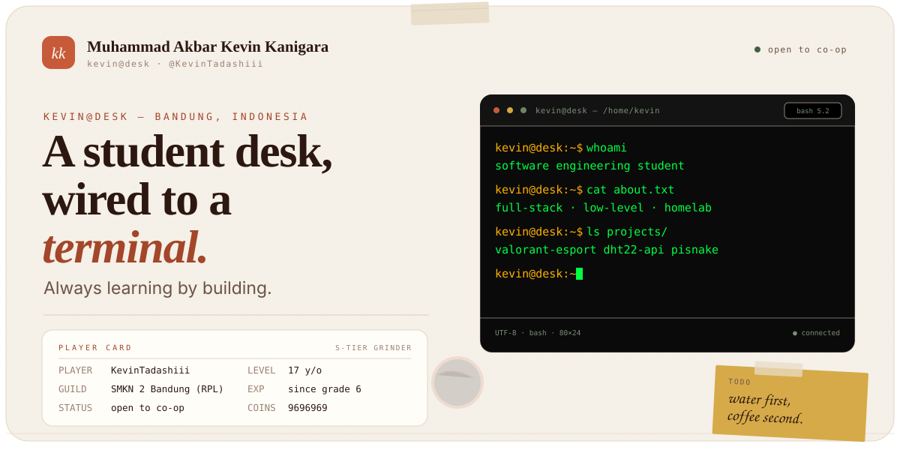
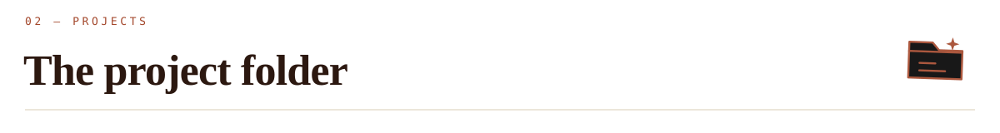
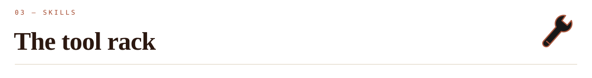
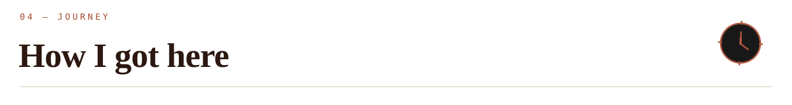
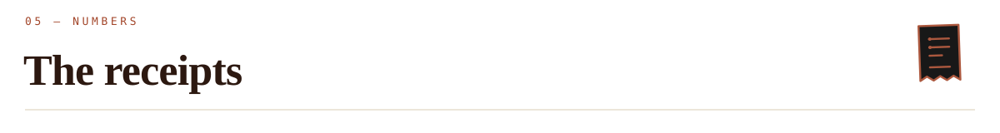
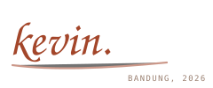

<!-- ── HERO ─────────────────────────────────────────────────────────────── -->

<p align="center">
  <picture>
    <source media="(prefers-color-scheme: dark)" srcset="./.github/assets/hero-dark.svg">
    <source media="(prefers-color-scheme: light)" srcset="./.github/assets/hero-light.svg">
    
  </picture>
</p>

<p align="center">
  <sub><code>01</code> about &nbsp;·&nbsp; <code>02</code> projects &nbsp;·&nbsp; <code>03</code> skills &nbsp;·&nbsp; <code>04</code> journey &nbsp;·&nbsp; <code>05</code> numbers &nbsp;·&nbsp; <code>06</code> contact</sub>
</p>

<!-- ── 01 · ABOUT ──────────────────────────────────────────────────────── -->

<p>
  <picture>
    <source media="(prefers-color-scheme: dark)" srcset="./.github/assets/section-01-about-dark.svg">
    <source media="(prefers-color-scheme: light)" srcset="./.github/assets/section-01-about-light.svg">
    
  </picture>
</p>

**The short version.** I'm a 17-year-old Software Engineering student at **SMKN 2 Bandung (RPL)**, based in Bandung, Indonesia. I started coding in **6th grade** because I wanted to make a game that would get everyone's attention. The game never shipped; the code stuck.

> **field notes**
>
> It started in 6th grade. I wanted to make a game that would get everyone's attention. Turned out, the skill I needed most wasn't art or design, but programming. That was the entry point.
>
> I didn't stick with game development (the art side was a wall I couldn't climb), but I fell in love with the code itself. From 7th to 8th grade, I went deep into low-level programming: C, C++, understanding how memory and machines actually work.
>
> By 9th grade, the scope widened. Full-stack development became the playground: JavaScript, TypeScript, Linux, Docker, and now AI. Today I'm a Software Engineering student at SMKN 2 Bandung (RPL), still chasing the same feeling: building things that work, understanding them all the way down.

Outside the terminal: a homelab, a few games, and a habit of slithering through bugs. Currently learning **Laravel, Flutter, Next.js, Express.js, Tailwind CSS, PostgreSQL, Redis, CI/CD, and system design**.

**Current quest.** Master full-stack · expand the homelab · build more games · climb the ladder.

<!-- ── 02 · PROJECTS ───────────────────────────────────────────────────── -->

<p>
  <picture>
    <source media="(prefers-color-scheme: dark)" srcset="./.github/assets/section-02-projects-dark.svg">
    <source media="(prefers-color-scheme: light)" srcset="./.github/assets/section-02-projects-light.svg">
    
  </picture>
</p>

Ten entries live in the folder. Six are on the desk:

<table>
  <tr>
    <td width="50%" valign="top">
      <b><a href="https://github.com/KevinTadashiii/My-Portfolio">Portfolio</a></b><br>
      The site this desk borrows from: a Laravel app with a Blade front end, a hand-built terminal, and a few opinions about paper.<br>
      <sub><code>Laravel</code> · <code>PHP</code> · <code>Blade</code> · <code>Tailwind CSS</code> · <code>Alpine.js</code> · <code>Vite</code></sub>
    </td>
    <td width="50%" valign="top">
      <b><a href="https://github.com/KevinTadashiii/Valorant-Esport">Valorant Esport</a></b><br>
      A browser game where you build, manage, and lead a Valorant esports team through the competitive season.<br>
      <sub><code>TypeScript</code> · <code>Next.js</code> · <code>React</code> · <code>Tailwind CSS</code> · <code>Vitest</code></sub>
    </td>
  </tr>
  <tr>
    <td width="50%" valign="top">
      <b><a href="https://github.com/KevinTadashiii/Manajemen-Inventaris-Lab-RPL">RPL Lab Inventory</a></b><br>
      A Laravel dashboard for the school's RPL lab: categories, item records, and the equipment count at a glance.<br>
      <sub><code>Laravel</code> · <code>PHP</code> · <code>Blade</code> · <code>Tailwind CSS</code> · <code>SQLite</code> · <code>Vite</code></sub>
    </td>
    <td width="50%" valign="top">
      <b><a href="https://github.com/KevinTadashiii/simple-neural-network">Simple Neural Network</a></b><br>
      One neuron, no ML libraries: a from-scratch classifier trained with sigmoid, mean squared error, and gradient descent.<br>
      <sub><code>Python</code> · <code>uv</code> · <code>Gradient Descent</code></sub>
    </td>
  </tr>
  <tr>
    <td width="50%" valign="top">
      <b><a href="https://github.com/KevinTadashiii/DHT22-API">DHT22 API</a></b><br>
      ESP32 firmware that reads a DHT22 sensor and serves temperature and humidity over HTTP on the local network.<br>
      <sub><code>C</code> · <code>ESP-IDF</code> · <code>ESP32</code> · <code>FreeRTOS</code> · <code>HTTP</code></sub>
    </td>
    <td width="50%" valign="top">
      <b><a href="https://github.com/KevinTadashiii/PISNAKE">PISNAKE</a></b><br>
      A snake game built with LÖVE and Lua: my first finished game loop, from window setup to collision and scoring.<br>
      <sub><code>Lua</code> · <code>LÖVE</code></sub>
    </td>
  </tr>
</table>

<sub>The other four — CPB Interpreter, Rusty Brainfuck Interpreter, Mono Calculator, and First Portfolio Site — are in the folder. <a href="https://kevinkanigara.my.id/#projects">Open the full folder →</a></sub>

<!-- ── 03 · SKILLS ─────────────────────────────────────────────────────── -->

<p>
  <picture>
    <source media="(prefers-color-scheme: dark)" srcset="./.github/assets/section-03-skills-dark.svg">
    <source media="(prefers-color-scheme: light)" srcset="./.github/assets/section-03-skills-light.svg">
    
  </picture>
</p>

<table>
  <tr>
    <td width="33%" valign="top">
      <sub><b>LANGUAGES</b></sub><br><br>
      <code>HTML5</code> <code>CSS3</code> <code>JavaScript</code><br>
      <code>TypeScript</code> <code>Python</code> <code>C</code><br>
      <code>C++</code> <code>Rust</code> <code>Kotlin</code>
    </td>
    <td width="33%" valign="top">
      <sub><b>FRAMEWORKS</b></sub><br><br>
      <code>React</code> <code>Next.js</code> <code>Tailwind</code><br>
      <code>Laravel</code> <code>Express.js</code><br>
      <code>FastAPI</code> <code>Flutter</code>
    </td>
    <td width="33%" valign="top">
      <sub><b>WORKBENCH</b></sub><br><br>
      <code>MySQL</code> <code>Docker</code> <code>Postman</code><br>
      <code>Git</code> <code>GitHub</code> <code>VS Code</code><br>
      <code>JetBrains</code> <code>Linux</code> <code>Windows</code>
    </td>
  </tr>
  <tr>
    <td colspan="3" valign="top">
      <sub><b>ON THE DESK NEXT</b> — <code>PostgreSQL</code> <code>Redis</code> <code>CI/CD</code> <code>System Design</code></sub>
    </td>
  </tr>
</table>

**Margin notes.** The desk keeps a small status file:

```console
kevin@desk:~$ cat ~/notes/current_state.txt
problem_solving ....... 90/100
learning_agility ...... MAX
linux_and_homelab ..... MAX
bug_slithering ........ MAX
caffeine_level ........ 0/100
smkn2_pride ........... ∞/100
kevin@desk:~$ _
```

<!-- ── 04 · JOURNEY ────────────────────────────────────────────────────── -->

<p>
  <picture>
    <source media="(prefers-color-scheme: dark)" srcset="./.github/assets/section-04-journey-dark.svg">
    <source media="(prefers-color-scheme: light)" srcset="./.github/assets/section-04-journey-light.svg">
    
  </picture>
</p>

<table>
  <tr>
    <td width="16%" valign="top"><code>2019</code><br><sub>grade 6</sub></td>
    <td valign="top"><b>The game that started it all</b> — wanted to build a game to impress everyone; discovered programming was the skill required. First bug squashed. The game never shipped, but the code stuck. <sub><code>first blood · unlocked</code></sub></td>
  </tr>
  <tr>
    <td width="16%" valign="top"><sub>grade 7–8</sub></td>
    <td valign="top"><b>Low-level foundations</b> — C and C++ became daily drivers. Pointers, memory management, compilation: the unglamorous layer that makes everything else possible. Learned to read errors instead of fearing them. <sub><code>unlocked</code></sub></td>
  </tr>
  <tr>
    <td width="16%" valign="top"><sub>grade 9–10</sub></td>
    <td valign="top"><b>Full-stack expansion</b> — JavaScript, TypeScript, Node.js, databases, Linux servers, Docker. The stack grew horizontally. First deployments, first real users, first production bugs at 2 AM. <sub><code>unlocked</code></sub></td>
  </tr>
  <tr>
    <td width="16%" valign="top"><sub>grade 11</sub></td>
    <td valign="top"><b>Software Engineering Student (RPL)</b> — SMKN 2 Bandung. Structured learning, team projects, and the shift from “it works” to “it's maintainable.” Also raised a home server rack and tamed it. <sub><code>homelab lord · unlocked</code></sub></td>
  </tr>
  <tr>
    <td width="16%" valign="top"><sub>4+ years</sub></td>
    <td valign="top"><b>Still shipping</b> — 4+ years grinding code without quitting. The web dev main quest line is cleared; the leaderboard is still being climbed. <sub><code>speedrunner · full-stack wizard · unlocked</code></sub></td>
  </tr>
  <tr>
    <td width="16%" valign="top"><sub>next</sub></td>
    <td valign="top"><b>Something new</b> — a hidden achievement, a snake to charm, and a few projects that don't exist yet. Keep playing. <sub><code>snake charmer · in progress</code> · <code>??? · locked</code></sub></td>
  </tr>
</table>

<!-- ── 05 · NUMBERS ────────────────────────────────────────────────────── -->

<p>
  <picture>
    <source media="(prefers-color-scheme: dark)" srcset="./.github/assets/section-05-numbers-dark.svg">
    <source media="(prefers-color-scheme: light)" srcset="./.github/assets/section-05-numbers-light.svg">
    
  </picture>
</p>

The desk keeps score. The cards refresh themselves; the graphs are rebuilt every night.

<table align="center">
  <tr>
    <td align="center" valign="middle">
      <picture>
        <source media="(prefers-color-scheme: dark)" srcset="https://github-stats-extended.vercel.app/api?username=KevinTadashiii&amp;show_icons=true&amp;rank_icon=github&amp;include_all_commits=true&amp;custom_title=the+desk+log&amp;bg_color=211A15&amp;title_color=E07A54&amp;text_color=F5EBDD&amp;icon_color=D4A843&amp;border_color=3B2D24">
        <source media="(prefers-color-scheme: light)" srcset="https://github-stats-extended.vercel.app/api?username=KevinTadashiii&amp;show_icons=true&amp;rank_icon=github&amp;include_all_commits=true&amp;custom_title=the+desk+log&amp;bg_color=FFFDF8&amp;title_color=A3462A&amp;text_color=2C1810&amp;icon_color=C75B39&amp;border_color=E2D6C4">
        
      </picture>
    </td>
    <td align="center" valign="middle">
      <picture>
        <source media="(prefers-color-scheme: dark)" srcset="./.github/assets/streak-dark.svg">
        <source media="(prefers-color-scheme: light)" srcset="./.github/assets/streak-light.svg">
        
      </picture>
    </td>
  </tr>
  <tr>
    <td colspan="2" align="center">
      <picture>
        <source media="(prefers-color-scheme: dark)" srcset="https://github-stats-extended.vercel.app/api/top-langs?username=KevinTadashiii&amp;langs_count=5&amp;layout=compact&amp;custom_title=tool+usage&amp;bg_color=211A15&amp;title_color=E07A54&amp;text_color=F5EBDD&amp;border_color=3B2D24">
        <source media="(prefers-color-scheme: light)" srcset="https://github-stats-extended.vercel.app/api/top-langs?username=KevinTadashiii&amp;langs_count=5&amp;layout=compact&amp;custom_title=tool+usage&amp;bg_color=FFFDF8&amp;title_color=A3462A&amp;text_color=2C1810&amp;border_color=E2D6C4">
        
      </picture>
    </td>
  </tr>
</table>

**The machines.** Two contribution graphs, rebuilt every night by GitHub Actions.

<p align="center">
  <picture>
    <source media="(prefers-color-scheme: dark)" srcset="https://raw.githubusercontent.com/KevinTadashiii/KevinTadashiii/output/github-contribution-grid-snake-dark.svg">
    <source media="(prefers-color-scheme: light)" srcset="https://raw.githubusercontent.com/KevinTadashiii/KevinTadashiii/output/github-contribution-grid-snake.svg">
    
  </picture>
</p>

<p align="center">
  <picture>
    <source media="(prefers-color-scheme: dark)" srcset="https://raw.githubusercontent.com/KevinTadashiii/KevinTadashiii/output/pacman-contribution-graph-dark.svg">
    <source media="(prefers-color-scheme: light)" srcset="https://raw.githubusercontent.com/KevinTadashiii/KevinTadashiii/output/pacman-contribution-graph.svg">
    
  </picture>
</p>

<sub><code>snake.exe</code> and <code>pacman.exe</code> — same grid, two ways to lose an evening.</sub>

**After-hours leaderboard.** A few friends, a few scores, zero stakes.

| # | player | score | zone |
|:---:|:---|:---:|:---|
| `01` | **Kevin** `(you)` | `969696` | Bandung |
| `02` | Tejano | `087301` | Palembang |
| `03` | Razoor | `013370` | Jakarta |
| `04` | Ghost | `000000` | ??? |

<!-- ── 06 · CONTACT ────────────────────────────────────────────────────── -->

<p>
  <picture>
    <source media="(prefers-color-scheme: dark)" srcset="./.github/assets/section-06-contact-dark.svg">
    <source media="(prefers-color-scheme: light)" srcset="./.github/assets/section-06-contact-light.svg">
    
  </picture>
</p>

<table>
  <tr>
    <td width="33%" valign="top">
      <b>GitHub</b><br>
      <a href="https://github.com/KevinTadashiii"><code>@KevinTadashiii</code></a><br>
      <sub>the code, the commits, the works in progress.</sub>
    </td>
    <td width="33%" valign="top">
      <b>Portfolio</b><br>
      <a href="https://kevinkanigara.my.id"><code>kevinkanigara.my.id</code></a><br>
      <sub>the desk, in full.</sub>
    </td>
    <td width="33%" valign="top">
      <b>Email</b><br>
      <a href="mailto:kevintadashiii@gmail.com"><code>kevintadashiii@gmail.com</code></a><br>
      <sub>the fastest way to reach me.</sub>
    </td>
  </tr>
  <tr>
    <td width="33%" valign="top">
      <b>Instagram</b><br>
      <a href="https://www.instagram.com/bayabaytjn_/"><code>@bayabaytjn_</code></a><br>
      <sub>off-screen, mostly.</sub>
    </td>
    <td width="33%" valign="top">
      <b>Reddit</b><br>
      <a href="https://www.reddit.com/user/kevintadashi/"><code>u/kevintadashi</code></a><br>
      <sub>lurking with intent.</sub>
    </td>
    <td width="33%" valign="top">
      <b>Collaboration</b><br>
      <a href="mailto:kevintadashiii@gmail.com?subject=Let%27s%20build%20something"><code>open to co-op</code></a><br>
      <sub>bring a project.</sub>
    </td>
  </tr>
</table>

<sub>Based in Bandung, Indonesia — replies usually arrive faster than a letter.</sub>

<p align="center">
  <picture>
    <source media="(prefers-color-scheme: dark)" srcset="./.github/assets/signature-dark.svg">
    <source media="(prefers-color-scheme: light)" srcset="./.github/assets/signature-light.svg">
    
  </picture>
</p>

<p align="center">
  <i>“All things work together for good to them that love God.”</i><br>
  <sub>— Ed Warren, <i>In a Dark Place</i></sub>
</p>

<details>
<summary>☕ <b>open the desk drawer</b> — cheat codes, old notes, and one moonwalk</summary>

<br>

**Konami code** — <kbd>↑</kbd> <kbd>↑</kbd> <kbd>↓</kbd> <kbd>↓</kbd> <kbd>←</kbd> <kbd>←</kbd> <kbd>→</kbd> <kbd>→</kbd> <kbd>B</kbd> <kbd>A</kbd>

*+30 lives unlocked. Hee hee.*

<sub><code>git commit -m "fixed it"</code> · water first, coffee second · remember to back up</sub>

<p align="center">
  
</p>

</details>

<!-- ── COLOPHON ────────────────────────────────────────────────────────── -->

<p align="center">
  <sub>Muhammad Akbar Kevin Kanigara · Bandung, Indonesia · 2026</sub><br>
  <sub>README styled after <a href="https://kevinkanigara.my.id">kevinkanigara.my.id</a> · set in Lora &amp; JetBrains Mono</sub><br>
  <sub><a href="https://github.com/KevinTadashiii">GitHub</a> · <a href="mailto:kevintadashiii@gmail.com">Email</a> · <a href="#">back to the desk ↑</a></sub>
</p>

<p align="center">
  
</p>
